<div align="center">

🌐 **English** | [Português](README.md)

# FusionBrick

**Open-source modular design system for makers, engineers and builders.**

*Build smarter. Print faster. Connect everything.*

[](LICENSE)
[](https://openscad.org)
[](https://makerworld.com)
[](CHANGELOG.md)

</div>

---

## What is FusionBrick?

FusionBrick is a **parametric modular design system** for 3D printing. It provides a set of interlocking pieces — called **Bricks** — that connect in any direction, on any face, without tools.

Inspired by the simplicity of LEGO and the precision of engineering, FusionBrick is designed for:

- ⚡ **Rapid prototyping** of electronics cases, structures and brackets
- 🔩 **Press-fit assembly** — no screws, no glue required
- 📐 **Parametric design** — every dimension is a variable
- 🌐 **Open source** — fork it, extend it, share it

---

## Core Concepts

FusionBrick is built around one rule:

> **Any piece connects to any other piece, on any face, in any direction.**

Every piece has holes on the same 8 mm grid. On each face you get a printed **stud**, a **socket** that receives one, or a flat face; two facing sockets are joined by a loose **dowel**. Press-fit for prototyping, glued for permanent builds.

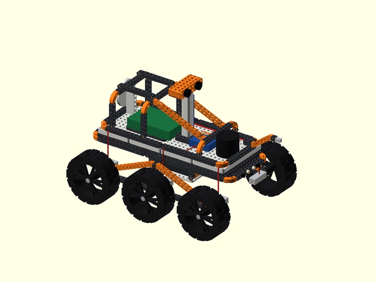

---

## The Pieces

Eight pieces in an assembly. Brick, beam, plate and cover are the same BRICK with different defaults; curve, strut, wheel and component cover what a block can't do.

| Piece | Preview | Description | Source |
| --- | :---: | --- | --- |
| **`brick`** | 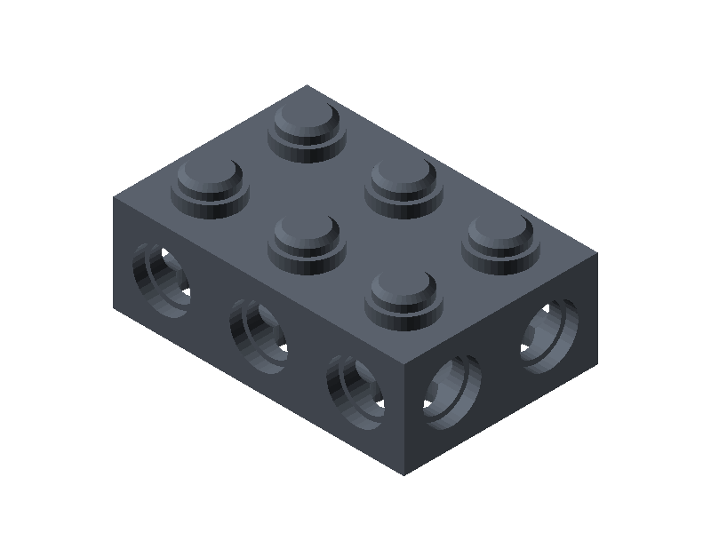 | The base piece. Any size in cells, holes per axis and, on each face, a stud, a socket or flat. Always orthogonal. | `impl/openscad/brick.scad` |
| **`beam`** | 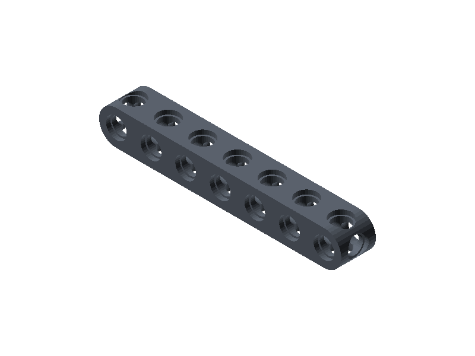 | 1×1×n bar holed on all three axes, rounded ends. The backbone of almost everything. | `brick.scad` variant |
| **`plate`** | 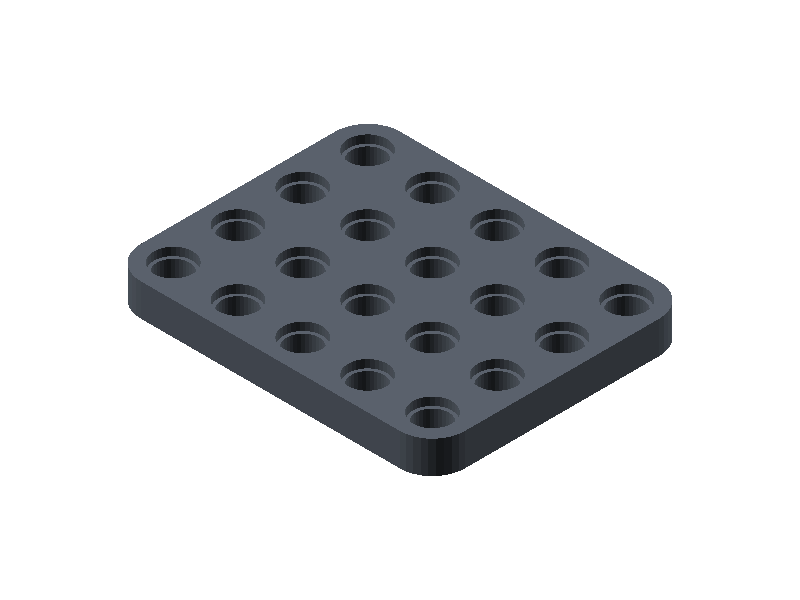 | 4 mm holed sheet, for floors and bases. | `brick.scad` variant |
| **`cover`** | 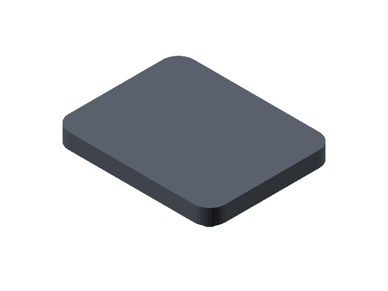 | Smooth sheet that closes the top, studs only around the bottom edge. | `brick.scad` variant |
| **`curve`** | 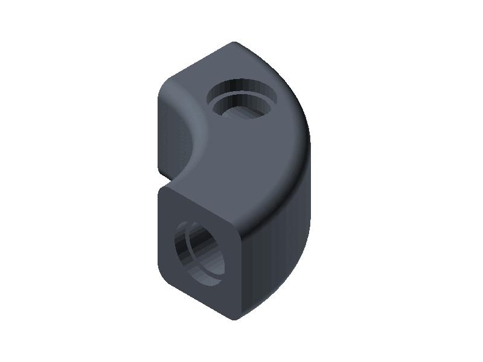 | Beam that turns 90° or 180°, in three radii. The exit lands on the grid. | `impl/openscad/curve.scad` |
| **`strut`** | 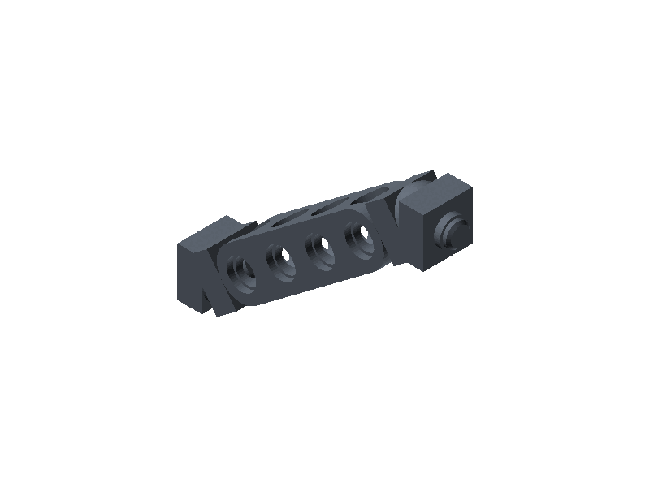 | Slanted beam between two cells; the end nodes are created for you. Only angles that close on the grid (3-4-5, 5-12-13…). | `impl/openscad/node.scad` + `brick.scad` |
| **`wheel`** | 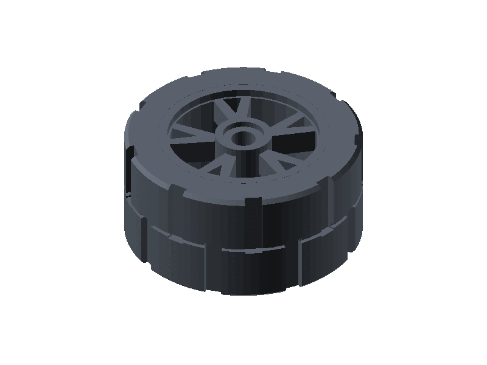 | Wheel with its axle, Ø24 to Ø112 mm, three tread types. | `impl/openscad/wheel.scad` + `axle.scad` |
| **`component`** | 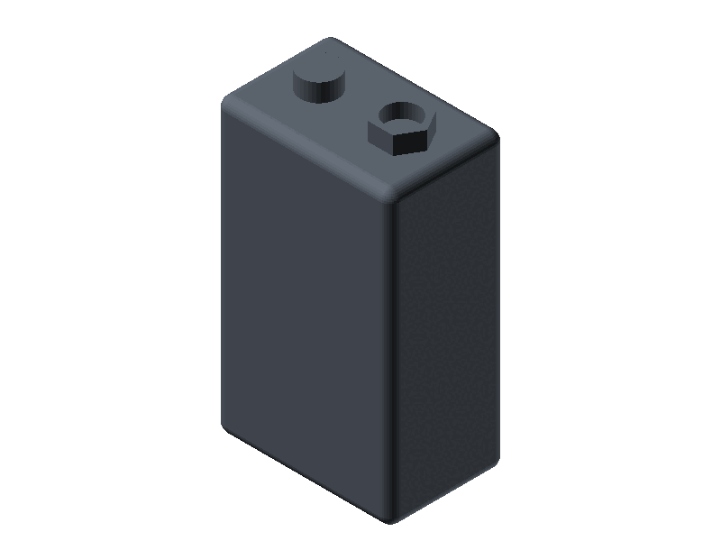 | What you buy ready-made (battery, board, motor, sensor). Not printed: reserves the volume at real size. | — |

The **PIN** (`impl/openscad/pin.scad`) is the dowel: the loose two-ended pin that joins two facing sockets. The compiler adds it for you.

**Connectors:** `stud` (pin printed on the face) · `socket` (recess that receives a pin) · `flat` (plain face) · dowel (two-ended PIN between two sockets).

The old pieces (ATOM, LINK, BRIDGE, CORNER, VERTEX, ELBOW) became configurations of BRICK or PIN.

---

## System Parameters

All pieces share the same global parameters. **Keep them equal across pieces to guarantee compatibility.**

```
hole_d    = 4.0mm   // hole diameter
wall      = 1.6mm   // wall around the hole
collar_w  = 0.4mm   // recess collar
tolerance = 0.2mm   // print fit tolerance
grid      = 8mm     // DERIVED: hole_d + 2·(wall + collar_w) — never declared
```

Single source: [`spec/params.md`](spec/params.md), generated from each part's contract.

System premises: [spec/constitution.md](spec/constitution.md) · Grid Law and joints: [spec/rules.md](spec/rules.md).

> **Compatibility rule:** the grid is derived from the hole, so every piece built from the same primitives lines up — no matter which pieces you combine.

---

## Quick Start

### Requirements
- [OpenSCAD](https://openscad.org/downloads.html) 2021+
- Any FDM printer (tested on Bambu Lab A1 Mini)
- PLA or PETG filament

### Print your first BRICK

1. Clone the repository
```bash
git clone https://github.com/fusionbrick/core.git
```

2. Open in OpenSCAD
```bash
cd fusionbrick
open impl/openscad/brick.scad
```

3. Render and export STL
```
Press F6 to render → File → Export → Export as STL
```

4. Slice and print
   - Layer height: `0.2mm`
   - Infill: `20%+`
   - Supports: `No`

### Or use pre-exported STLs
Pre-built STL files are available in the `renders/stl/` folder.

---

## Assembly by description

Assemblies are not drawn: they are **described** in `examples/<name>/assembly.toml` — which parts occupy which cells — and **compiled**. The compiler inserts every dowel, validates fit by the rules in [`spec/assembly.md`](spec/assembly.md) and generates the `.scad`, the STLs (one per unique configuration), the bill of materials and the build steps. This is what lets an AI build prototypes from text or images (skill `fusionbrick-assembly`).

Whoever builds uses a short vocabulary, one name per concept:

| Part (`type`) | What it is |
| --- | --- |
| `brick` | the base part: any size, with the holes and connectors you choose |
| `beam` | a holed bar with rounded ends |
| `plate` | a thin holed sheet, for floors and bases |
| `cover` | a smooth sheet that closes the top |
| `curve` | a beam that turns 90° or 180° |
| `strut` | a slanted beam between two points; the end nodes are created for you |
| `wheel` | a wheel, axle included |
| `component` | what you buy ready-made: battery, board, motor, wire |

Beam, plate and cover are the BRICK with defaults already chosen; any field written on the part overrides the default, so full parametric control is still there.

| Connector | | Face (front = +X) | |
| --- | --- | --- | --- |
| `stud` | a pin printed on the part | `front` · `back` | +X · −X |
| `socket` | a recess that receives a pin | `left` · `right` | +Y · −Y |
| `flat` | a plain face | `top` · `bottom` | +Z · −Z |

Two facing `socket`s get a **dowel** (the two-ended PIN), which the compiler adds by itself.

```toml
parts = [
  { id = "base",  type = "brick",     at = [0, 0, 0], size = [10, 6, 1] },
  { id = "rail",   type = "beam",      at = [0, 0, 1], size = [10, 1, 1], studs = "bottom" },
  { id = "foot",    type = "brick",     at = [1, 5, 1], size = [1, 1, 1] },
  { id = "ramp", type = "strut",     from = [2, 5, 1], to = [6, 5, 4] },      # 3-4-5 slope
  { id = "post", type = "brick",     at = [7, 5, 1], size = [1, 1, 4] },
  { id = "wheel",  type = "wheel",     at = [2, -1, 1], on = "rail.right", diameter = 4 },
  { id = "bat",   type = "component", at = [3, 1, 1], size_mm = [48.5, 26.5, 17.5], label = "9V" },
]
```

The OpenSCAD part parameters (`cells_x`, `face_zn = "pin"`…) did not change, and the older assembly names (`liftarm`, `bend`, `mock`, `cells`…) are still accepted. The bridge between the layers is in [`spec/assembly.md` § Nomes](spec/assembly.md#nomes).

| `buggy-vt2` — from a photo, high resolution (99 parts) | `buggy-vt` — from a photo: cage with diagonals | `rover-tub` — 4×4, open bed | `rover-scout` — 6×6, slab deck |
| --- | --- | --- | --- |
| 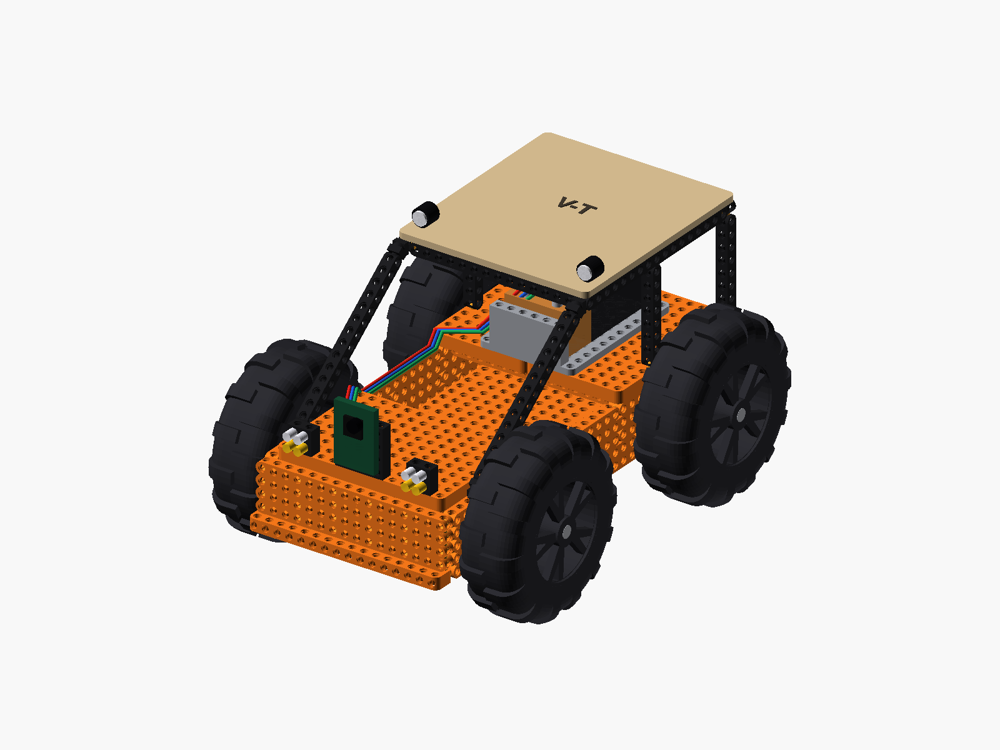 | 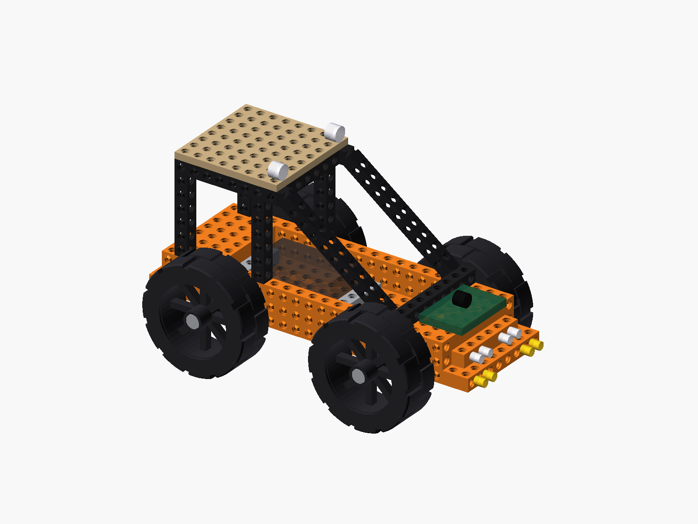 | 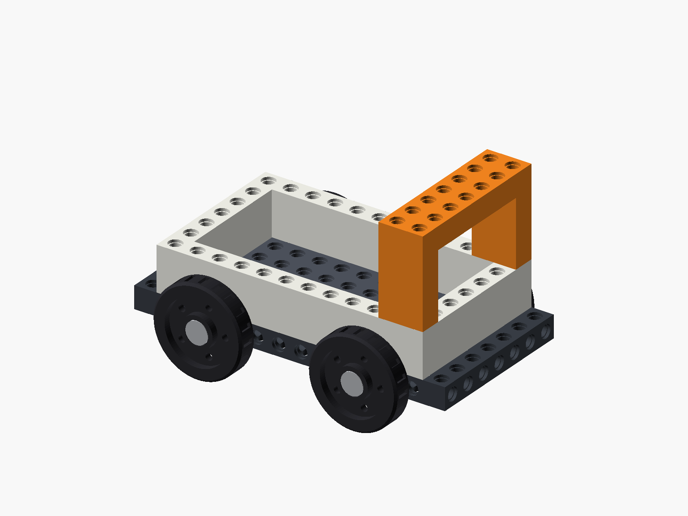 | 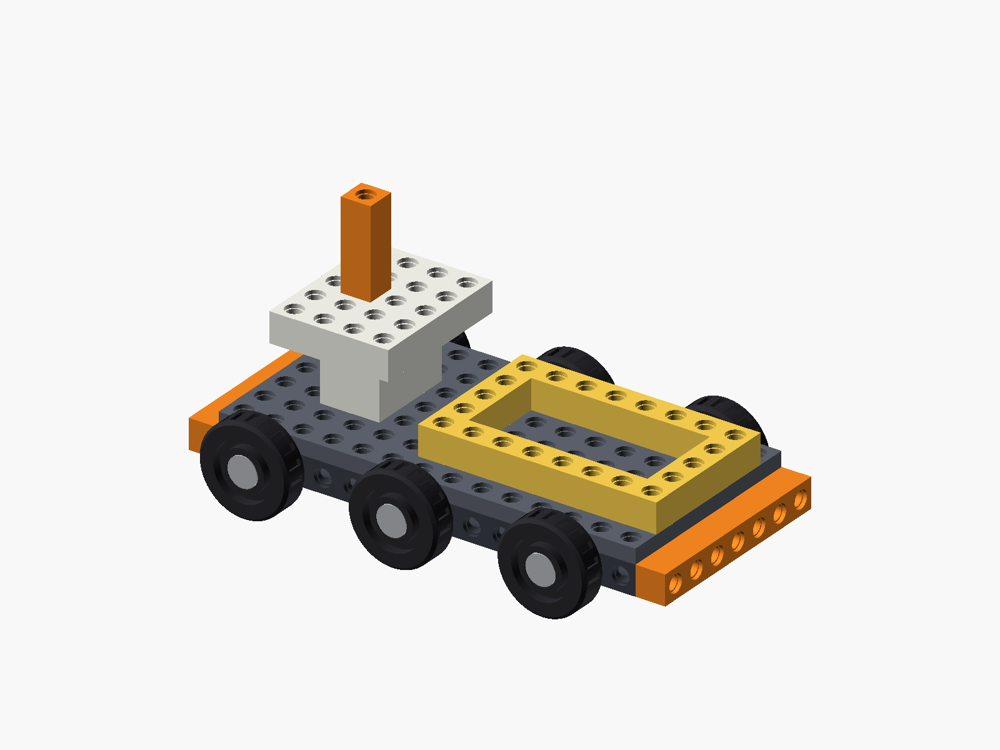 |

```bash
make assemble-check NAME=rover-tub   # validates in milliseconds
make assemble NAME=rover-tub         # STLs + .scad + BOM + steps + images
make assemble-collide NAME=rover-tub # exact pairwise intersection (CGAL)
```

---

## Project Structure

```text
FusionBrick/
├── spec/                    ← Generic specification (tech-agnostic)
│   ├── constitution.md     ← System premises
│   ├── params.md            ← Global parameters
│   ├── rules.md             ← Grid Law, interfaces, joints
│   └── parts/
│       ├── atom.md
│       ├── plate.md
│       ├── link.md
│       ├── bridge.md
│       └── corner.md
│
├── impl/
│   ├── openscad/            ← OpenSCAD implementation ✅
│   │   ├── atom.scad
│   │   ├── plate.scad
│   │   ├── link.scad
│   │   ├── bridge.scad
│   │   └── corner.scad
│   ├── fusion360/           ← Planned
│   └── manual/              ← Planned
│
├── renders/
│   ├── img/                 ← PNG previews
│   └── stl/                 ← Exported STL files
│
├── examples/                ← Example assemblies (make assembly)
└── docs/                    ← Documentation
```

---

## Roadmap

### v0.1.0 — Foundation ✅
- [x] ATOM — cubic unit
- [x] PLATE — flat surface
- [x] LINK — universal connector
- [x] OpenSCAD implementation
- [x] System specification

### v0.2.0 — Joints & Edge Interface ✅
- [x] Edge interface: Ø3 holes + recesses on PLATE sides
- [x] BRIDGE — invisible coplanar joint (dowels + buried web)
- [x] CORNER — 90° corner beam with ribs and wire channel
- [x] Wire channel by default in every connector
- [x] Grid Law formalized (`spec/constitution.md`, `spec/rules.md`)
- [x] `make assembly` — isometric assemblies with collision testing

### v0.3.0 — Assembly by description ✅
- [x] 8 mm grid derived from the hole, connector drawn once
- [x] Pieces: brick, beam, plate, cover, curve, strut, wheel, component
- [x] Assembly compiler (`assembly.toml`) with ASM-### rules and a quality sheet
- [x] Examples: buggies, test assemblies and the Rover Orion

### v0.4.0 — Parametric
- [ ] Hole pattern selection (all, edges, corners)
- [ ] Multi-scale support (10mm, 20mm, 30mm grid)
- [ ] MakerWorld PMM upload

### v0.5.0 — Connected
- [ ] Pivot pin (articulated suspension and arms)
- [ ] Motor-to-wheel hub
- [ ] Magnetic snap connectors
- [ ] Wireless integration layer

### v1.0.0 — Plugin
- [ ] Fusion 360 plugin — apply pattern to any surface
- [ ] Auto-split for large models
- [ ] Community blueprint library

---

## Implementations

FusionBrick follows a **spec-first** approach. The `spec/` folder defines the system contract — any CAD tool can implement it.

| Implementation | Status | Maintainer |
|---|---|---|
| OpenSCAD | ✅ Active | @wguilherme |
| Fusion 360 | 🔜 Planned | — |
| FreeCAD | 🔜 Planned | — |
| MakerWorld PMM | 🔜 Planned | — |

Want to add a new implementation? Read [CONTRIBUTING.md](CONTRIBUTING.md).

---

## Contributing

FusionBrick is open source and community-driven.

- 🐛 **Found a bug?** Open an [issue](https://github.com/fusionbrick/core/issues)
- 💡 **Have an idea?** Start a [discussion](https://github.com/fusionbrick/core/discussions)
- 🔧 **Want to contribute?** Read [CONTRIBUTING.md](CONTRIBUTING.md)
- 🖨️ **Printed something cool?** Share it on MakerWorld tagging **#fusionbrick**

---

## License

FusionBrick is released under the [MIT License](LICENSE).

Free to use, modify and distribute — personal and commercial.

---

<div align="center">

**FusionBrick** — *Build smarter. Print faster. Connect everything.*

Made with ❤️ by makers, for makers.

</div>