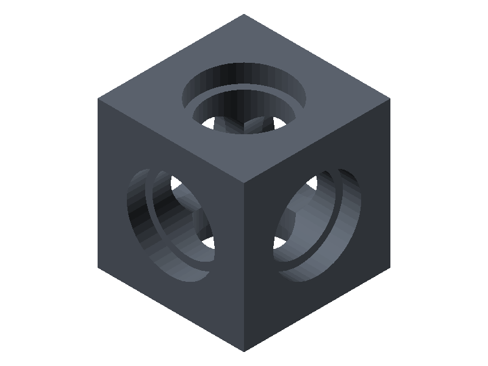
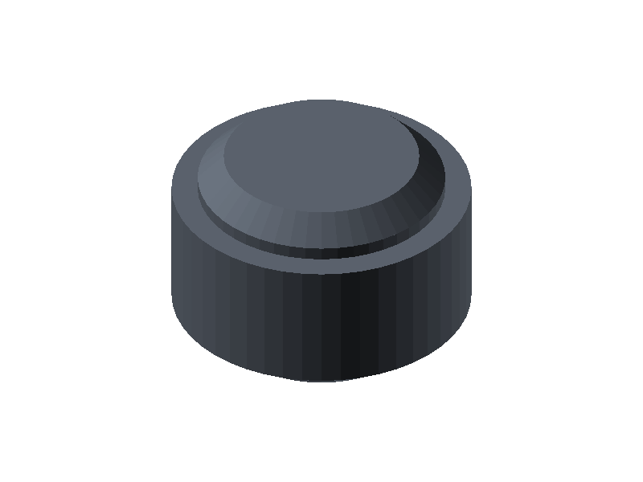
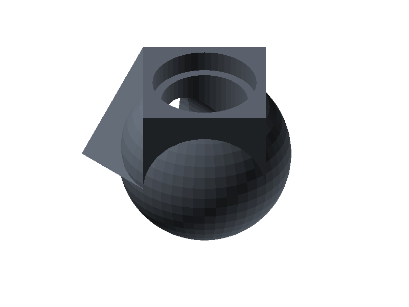
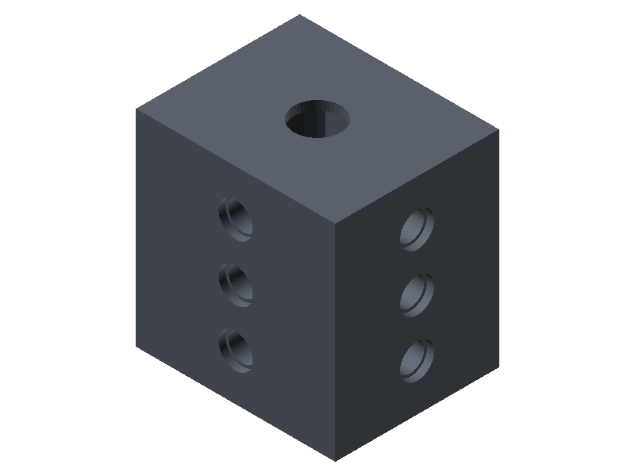
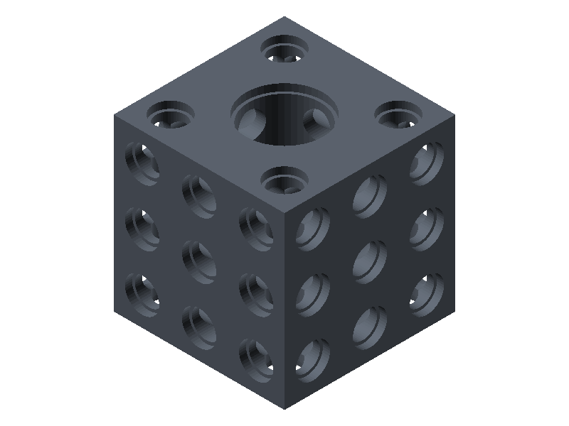
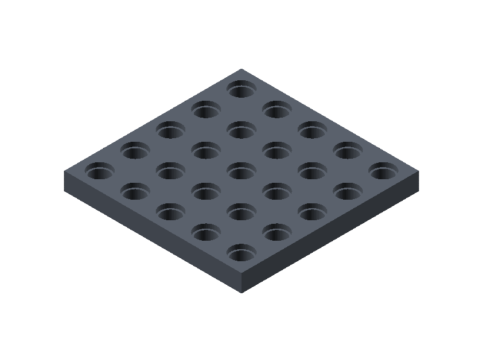
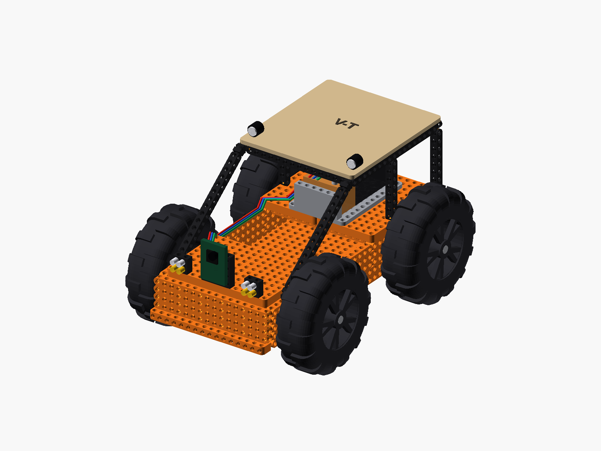
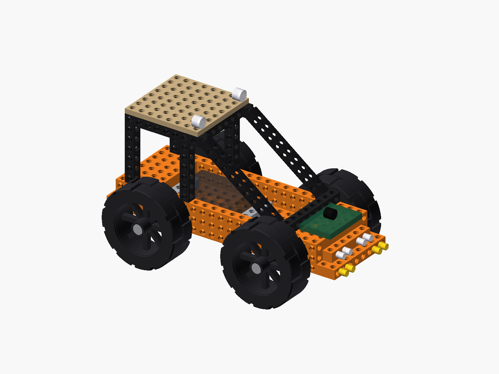
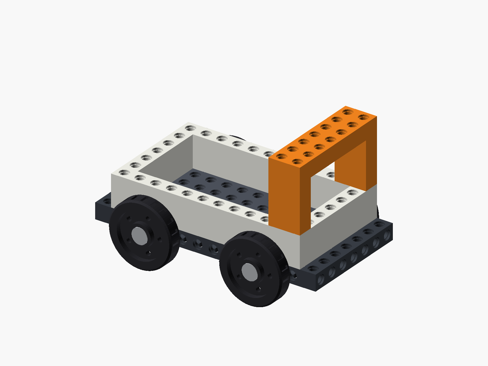
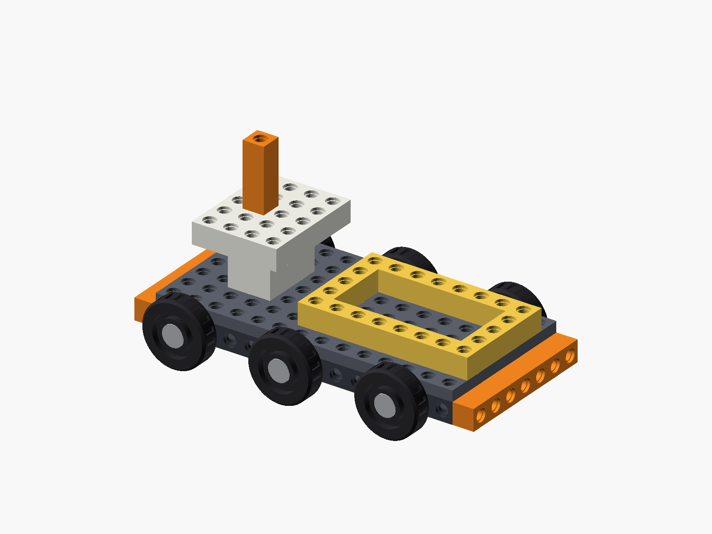

<div align="center">

🌐 **Português** | [English](README.en.md)

# FusionBrick

**Sistema de design modular open-source para makers, engenheiros e entusiastas.**

[](LICENSE)
[](https://openscad.org)
[](CHANGELOG.md)

</div>

---

FusionBrick é um sistema de componentes modulares paramétricos para impressão 3D. Qualquer componente conecta em qualquer outro — em qualquer face, em qualquer direção — via press-fit, sem ferramentas.


---

## Componentes

Quatro peças. O sistema colapsou de treze para quatro porque a maioria era o mesmo objeto em configuração diferente.

| Componente | Preview | Função | Fonte |
| --- | :---: | --- | --- |
| **BRICK** |  | Bloco universal. `cells_x/y/z`, eixos `bored`/`solid`, faces `recess`/`pin`/`plain`. Sempre ortogonal. | `impl/openscad/brick.scad` |
| **PIN** |  | O único macho solto. Uma ou duas pontas, qualquer escala. Quem retém é o colar. | `impl/openscad/pin.scad` |
| **NODE** |  | Única peça fora do ortogonal. N portas em ângulo livre, declaradas por direção. | `impl/openscad/node.scad` |
| **DOCK** |  | Adapter: hospeda dispositivo externo. Por dentro exclusivo, por fora BRICK. | `impl/openscad/dock.scad` |

### Variantes persistidas

Configuração que se repete vira arquivo, não peça nova: importa o BRICK, reatribui parâmetros e ganha preview e STL automáticos. Não conta no catálogo — é o mesmo componente.

| Variante | Preview | Configuração | Fonte |
| --- | :---: | --- | --- |
| **HUB** |  | BRICK `3×3×3` com furo macro `Ø10` no centro. É o que era o ATOM. | `impl/openscad/hub.scad` |
| **PLATE** |  | Chão e parede. Laje de `4mm` (`grid/2`), campo de furos fêmea nos dois lados, costas planas. | `impl/openscad/plate.scad` |

### O que o BRICK absorveu

| Antes | Configuração |
| --- | --- |
| ATOM | `1×1×1`, eixos `bored`, faces `recess` |
| PLATE `n×m` | `n×m×1` |
| Viga de `n` células | `1×1×n`, eixo longo `bored`, laterais `solid` |
| CORNER | `1×1×n`, duas faces adjacentes `pin` |
| VERTEX | `1×1×1`, eixos `solid`, três faces `pin` |
| ELBOW 90° | `1×1×1`, duas faces adjacentes `pin` |

**Toda união ortogonal é um BRICK** — as portas de uma união a 90° caem exatamente nos centros de face da célula. Só ângulo não-ortogonal precisa de NODE.

BRIDGE, LINK e LINK-ONESIDE viraram **PIN** em escalas e formas diferentes.

---

## Parâmetros Globais

O grid é **derivado**, não declarado. Dois primitivos e o resto sai deles.

```text
PRIMITIVOS
  hole_d       = 4.0mm    furo passante — a interface mecânica
  wall         = 1.6mm    parede interna mínima (4 perímetros de 0.4)
  collar_w     = 0.4mm    degrau radial do rebaixo (1 bico)
  collar_depth = 1.0mm    profundidade do rebaixo (5 camadas)
  tolerance    = 0.2mm    folga de press-fit
  gap          = 0.5mm    folga entre machos que se aproximam

DERIVADOS
  grid     = hole_d + 2·(wall + collar_w)      = 8.0mm
  recess_d = hole_d + 2·collar_w               = 4.8mm
  pin_d    = hole_d − tolerance                = 3.8mm
  pin_len  = wall + collar_w + tolerance/2 − gap = 1.6mm
```

Invariantes que caem de graça: **lasca na quina = parede** e **alma entre furos = 2 × parede**.

Detalhes em [spec/constitution.md](spec/constitution.md) e [spec/params.md](spec/params.md).

---

## Início Rápido

**Requisitos:** OpenSCAD 2021+, impressora FDM, PLA ou PETG.

### 1. Instalar OpenSCAD

Via [download direto](https://openscad.org/downloads.html) ou via asdf:

```bash
asdf plugin add openscad https://github.com/gabrielelana/asdf-openscad
asdf install  # lê a versão de .tool-versions (2021.01)
```

### 2. Clonar e abrir

```bash
git clone https://github.com/wguilherme/FusionBrick.git
cd FusionBrick
open impl/openscad/brick.scad
```

Dentro do OpenSCAD: ajuste os parâmetros no painel lateral (ex: `atom_size`, `hole_d`, `border_radius`) → `F6` para renderizar → `File → Export → Export as STL`.

### 3. Gerar previews e STLs via Make

```bash
make preview            # renders/img/*.png — imagem isométrica de cada componente
make preview-animated   # renders/img/*.gif — giro 360° de cada componente
make build              # renders/stl/*.stl — STL pronto para fatiar
make assembly           # examples/*/assembly*.png — montagens isométricas (normal + explodida)
make assembly-animated  # examples/*/assembly.gif — giro 360° com explode/recolhe em loop
```

Para sobrescrever a cor dos componentes no preview:

```bash
make preview PART_COLOR="[0.8, 0.2, 0.1]"  # valores 0.0–1.0 (RGB)
```

Velocidade/suavidade dos GIFs animados:

```bash
make preview-animated ANIM_DELAY=10   # delay entre frames em 1/100s (padrão: 15)
make preview-animated ANIM_FRAMES=72  # frames por volta — mais suave (padrão: 36)

make assembly-animated ASM_ANIM_DELAY=10    # delay entre frames (padrão: 5)
make assembly-animated ASM_ANIM_FRAMES=96   # frames no loop completo (padrão: 72)
make assembly-animated ASM_ANIM_EXPLODE=20  # afastamento máximo em mm (padrão: 12)
make assembly-animated ASM_ANIM_SPIN=360    # habilita o giro completo (padrão: 0 — câmera isométrica fixa)
make assembly-animated ASM_ANIM_SPEED=2     # 2x mais rápido (padrão: 1; 0.5 = metade da velocidade)
```

Por padrão a câmera fica travada no ângulo isométrico (45°/54.7°) e a animação só abre/recolhe a montagem.

### 4. Mudar os parâmetros do sistema

Toda variável ajustável mora em `hack/automations/variables.mk`. Os seis primitivos entram em **toda** chamada do OpenSCAD, então mudar um valor muda o sistema inteiro de forma coerente — as peças recalculam grid, rebaixo, pino e colar sozinhas.

```bash
make vars    # config efetiva + derivados, antes de gerar qualquer coisa
```

Para config local persistente, copie `.env.example` para `.env` na raiz (não é versionado):

```bash
cp .env.example .env
```

```bash
# .env — formato de makefile: sem aspas, sem export
TOLERANCE=0.15
FN=16
```

Precedência, do menor para o maior:

| | Onde | Exemplo |
| --- | --- | --- |
| 1 | default no `.scad` | `hole_d = 4.0;` |
| 2 | default em `variables.mk` | `HOLE_D ?= 4.0` |
| 3 | `.env` na raiz | `HOLE_D=5.0` |
| 4 | variável na linha | `make build HOLE_D=5.0` |
| 5 | `EXTRA_D` | `make build EXTRA_D='-D hole_d=5.0'` |

Não existe um `GRID` ajustável: ele é **derivado** (`hole_d + 2·(wall + collar_w)`). Expor grid permitiria pedir um grid que não fecha com o próprio furo.

O caso mais comum é calibrar o encaixe para a sua impressora — se o par sair frouxo, baixe a tolerância:

```bash
make build TOLERANCE=0.15
```

---

## Montagem por descrição

Montagens não são desenhadas: são **descritas** em `examples/<nome>/assembly.toml` — quais peças ocupam quais células — e **compiladas**. O compilador insere cada cavilha, valida o encaixe pelas regras de [`spec/assembly.md`](spec/assembly.md) e gera o `.scad`, os STLs (um por configuração única), a lista de peças e o passo a passo. É o que permite gerar protótipos a partir de texto ou imagem com IA (skill `fusionbrick-assembly`).

Quem monta usa um vocabulário curto, com um nome por conceito:

| Peça (`type`) | O que é |
| --- | --- |
| `brick` — bloco | a peça-base: qualquer tamanho, furos e encaixes que você escolher |
| `beam` — viga | barra furada de pontas redondas |
| `plate` — placa | chapa fina furada, para pisos e bases |
| `cover` — tampa | chapa lisa que fecha por cima |
| `curve` — curva | viga que vira 90° ou 180° |
| `strut` — diagonal | viga inclinada entre dois pontos; os nós das pontas são criados sozinhos |
| `wheel` — roda | roda com eixo incluso |
| `component` — componente | o que você compra pronto: bateria, placa, motor, fio |

Viga, placa e tampa são o BRICK com padrões já escolhidos; qualquer campo escrito na peça vence o padrão, então o controle paramétrico completo continua disponível.

| Encaixe | | Face (frente = +X) | |
| --- | --- | --- | --- |
| `stud` | pino que já sai impresso na peça | `front` · `back` | +X · −X |
| `socket` | encaixe que recebe um pino | `left` · `right` | +Y · −Y |
| `flat` | face lisa | `top` · `bottom` | +Z · −Z |

Dois `socket` frente a frente recebem uma **cavilha** (o PIN de duas pontas), que o compilador põe sozinho.

```toml
parts = [
  { id = "base",  type = "brick",     at = [0, 0, 0], size = [10, 6, 1] },
  { id = "viga",  type = "beam",      at = [0, 0, 1], size = [10, 1, 1], studs = "bottom" },
  { id = "pe",    type = "brick",     at = [1, 5, 1], size = [1, 1, 1] },
  { id = "rampa", type = "strut",     from = [2, 5, 1], to = [6, 5, 4] },      # diagonal 3-4-5
  { id = "poste", type = "brick",     at = [7, 5, 1], size = [1, 1, 4] },
  { id = "roda",  type = "wheel",     at = [2, -1, 1], on = "viga.right", diameter = 4 },
  { id = "bat",   type = "component", at = [3, 1, 1], size_mm = [48.5, 26.5, 17.5], label = "9V" },
]
```

Os nomes das peças no OpenSCAD (`cells_x`, `face_zn = "pin"`…) não mudaram, e os nomes antigos da montagem (`liftarm`, `bend`, `mock`, `cells`…) continuam aceitos. A ponte entre as camadas está em [`spec/assembly.md` § Nomes](spec/assembly.md#nomes).

| `buggy-vt2` — a partir de foto, alta resolução (99 peças) | `buggy-vt` — a partir de foto: gaiola com diagonais | `rover-tub` — 4×4, caçamba aberta | `rover-scout` — 6×6, deck em placa |
| --- | --- | --- | --- |
|  |  |  |  |

```bash
make assemble-check NAME=rover-tub   # valida em milissegundos
make assemble NAME=rover-tub         # STLs + .scad + BOM + passos + imagens
make assemble-collide NAME=rover-tub # interseção exata par a par (CGAL)
```

---

## Estrutura

```text
FusionBrick/
├── spec/                   ← especificação independente de ferramenta
│   ├── constitution.md    ← premissas do sistema
│   ├── params.md           ← parâmetros globais
│   ├── rules.md            ← Lei do Grid, interfaces, junções
│   └── parts/              ← spec de cada peça
├── impl/
│   ├── openscad/           ← implementação OpenSCAD ✅
│   ├── fusion360/          ← planejado
│   └── manual/             ← planejado
├── renders/
│   ├── img/                ← previews PNG
│   └── stl/                ← STLs exportados
└── examples/               ← montagens de exemplo (make assembly)
```

---

## Roadmap

### v0.1.0 — Fundação ✅

- [x] ATOM, PLATE, LINK
- [x] Implementação OpenSCAD
- [x] Especificação do sistema

### v0.2.0 — Junções & Interface de Borda ✅

- [x] Interface de borda: furos Ø3 nas extremidades de PLATEs e ATOMs, com rebaixo para colar
- [x] BRIDGE — dowel de junção coplanar invisível com colar central
- [x] CORNER — viga de canto 90° com canal para fio; dois CORNERs formam "L" flush
- [x] PIN — viga conectora configurável (pino/furo/nada por face) com presets
- [x] ELBOW — curva 90° arredondada; VERTEX — quina 3-vias com ponta arredondada
- [x] Canal para circuito elétrico por padrão em todo conector
- [x] Lei do Grid formalizada (`spec/constitution.md`, `spec/rules.md`)
- [x] `make assembly` — montagens isométricas com teste de colisão

### v0.3.0 — Paramétrico

- [ ] Seleção de padrão de furos (bordas, cantos, todos)
- [ ] Suporte multi-escala (grid derivado de hole_d + wall)
- [ ] Upload MakerWorld PMM

### v0.4.0+ — Futuro

- [ ] Canais para condução elétrica
- [ ] Conectores magnéticos
- [ ] Plugin Fusion 360

---

## Implementações

| Implementação | Status |
| --- | --- |
| OpenSCAD | ✅ Ativo |
| Fusion 360 | 🔜 Planejado |
| FreeCAD | 🔜 Planejado |
| MakerWorld PMM | 🔜 Planejado |

Quer contribuir? [Abra uma issue](https://github.com/wguilherme/FusionBrick/issues) ou envie um PR.

---

Feito com ❤️ para quem constrói  — [@wguilherme](https://github.com/wguilherme)
